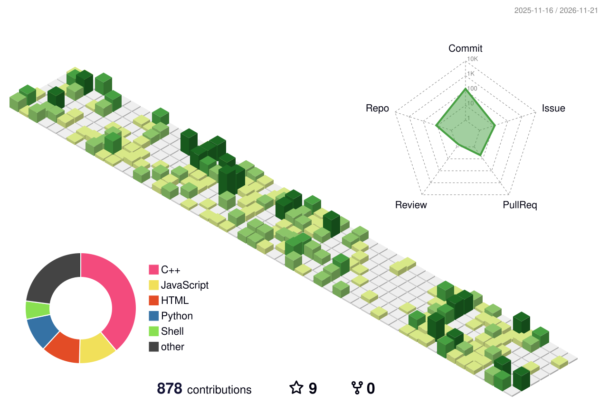

<a href="README.md">🇯🇵 日本語</a>

## About Me
- Kazuma Kurokawa
- From Nara Prefecture
- University of Tsukuba
  - School of Science and Engineering, Department of Engineering Systems (April 2024–)
- Qualifications
  - Third-Class Amateur Radio Operator (August 2024)

## Activities
  - Mitsume Laboratory, University of Tsukuba (June 2026 – present)
    - Assignments Through the Pioneering Researcher Experience Program
    - Research Topic: Development of a Framework for the Automatic Generation of Hydrodynamic Digital Twins Using Drone Footage
  - University of Tsukuba “Yui” Project (April 2024 – )
    - A project led by undergraduate students to develop microsatellites (CubeSats)
    - Responsible for the design and development of communication systems and software
  - Part-time Tutoring Instructor (December 2024 – present)
    - Teaches high school senior-level math, physics, and chemistry, as well as middle school math
  - Chair, Freshman Welcome Committee, School of Engineering Systems (September 2024 – April 2025)

## Intern
- TeamLab Inc. (August 2026)
  - Participated in a two-week summer internship as a spatial design engineer

## What I'm Doing

## Links
- [Portfolio](http://k42uma.com)
- [GitHub](https://github.com/k42um/)
- [Twitter](https://x.com/k42uma)
- [Zenn](https://zenn.dev/k42uma)

---
*This file was automatically generated by machine translation from [README.md](README.md).*
